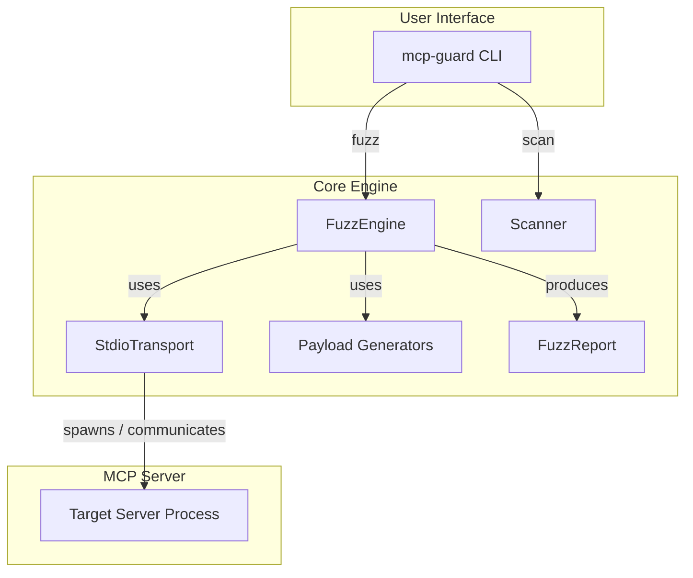
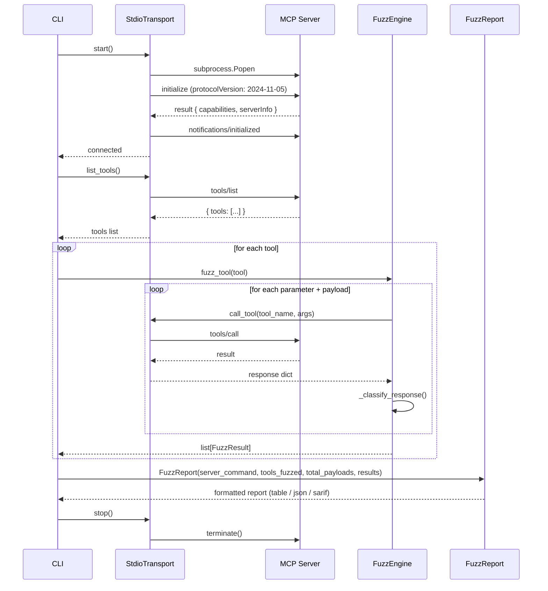
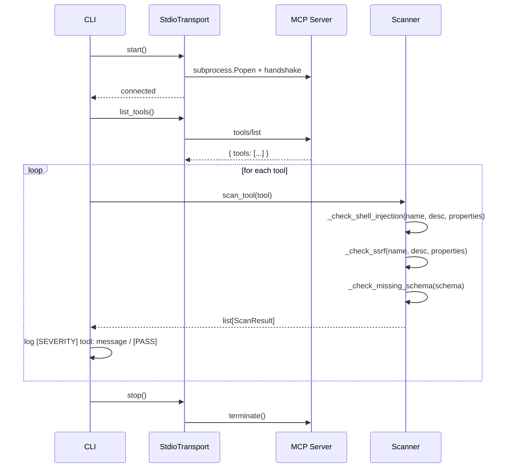

# Architecture

## Overview

mcp-guard is a zero-dependency Python library and CLI tool for adversarial fuzzing of MCP (Model Context Protocol) servers. It operates in two modes: **dynamic fuzzing** (spawning a server and sending real payloads) and **static scanning** (analyzing tool schemas — the server is spawned to enumerate itself, but no payloads are ever fired).



---

## Transport Layer

The transport layer handles all communication with the target MCP server. It is responsible for process lifecycle, JSON-RPC framing, and handshake negotiation.

### StdioTransport

`StdioTransport` spawns the target MCP server as a subprocess and communicates via stdin/stdout using newline-delimited JSON-RPC 2.0 messages.

**Key responsibilities:**

1. **Process Spawn**: Launches the server command with `subprocess.Popen`, piping stdin/stdout/stderr.
2. **Handshake**: Sends an `initialize` request with protocol version `2024-11-05` and client info (`mcp-guard`, `0.2.1`), then sends `notifications/initialized`.
3. **Request/Response**: Implements request-response correlation via incrementing `id` fields on JSON-RPC 2.0 request envelopes. Notification-shaped messages (`method` present, no `id`) are rejected as invalid responses.
4. **Error Handling**: Raises `ConnectionError` when the server process exits, closes its stdout, or returns a notification-shaped message. Raises `RuntimeError` on MCP-level errors. Raises `TimeoutError` when no response arrives within the configured timeout.
5. **Resource Management**: Supports context-manager protocol (`with` statement) for clean startup/shutdown. Terminates the process gracefully on exit, with a fallback to `kill()` if termination times out.
6. **Concurrency**: Strictly serial. `_read_response` spawns one reader thread per request (threading + queue) so a hung server cannot block the timeout; there is no request pipelining, and a timeout kills the server process outright.
7. **Flight Recorder**: `_send` records the exact JSON-RPC envelope of every request and `_read_response` records the response id, exposed via `last_exchange()`. This is the independent channel for fault-delivery verification (mcp-guard#65): the fuzzer checks the envelope against the intended call and the response id against the request id, instead of trusting the response content alone. Only the most recent exchange is kept; the fuzzer reads it immediately after each `call_tool`, and the engine is strictly serial, so one envelope is enough.

**Interface:**

```python
class StdioTransport:
    def __init__(self, command: list[str], timeout: float = 10.0) -> None: ...
    def start(self) -> None: ...
    def stop(self) -> None: ...
    def __enter__(self) -> StdioTransport: ...
    def __exit__(self, *args) -> None: ...
    @property
    def is_alive(self) -> bool: ...
    def list_tools(self) -> list[dict]: ...
    def list_resources(self) -> list[dict]: ...
    def list_prompts(self) -> list[dict]: ...
    def call_tool(self, tool_name: str, arguments: dict) -> dict: ...
    def last_exchange(self) -> tuple[JsonDict | None, Any]:
        """Flight recorder (mcp-guard#65): the exact envelope of the most
        recent tools/call send plus the id of its response."""
        ...
```

### Sequence Diagram: Dynamic Fuzzing Flow



---

## Fuzzing Engine

`FuzzEngine` is the core dynamic testing component. It receives a transport and a tool schema, generates targeted payloads, fires them, and classifies responses.

### Payload Generation

Payload generation is **schema-aware**. The engine inspects each parameter's `type` and `format` fields, plus parameter names, to select the appropriate payload suite.

```mermaid
flowchart TD
    A[fuzz_tool(tool)] --> B{has inputSchema?}
    B -->|No| C[_fuzz_no_schema]
    B -->|Yes| D{for each param}
    D --> E{is URI param?}
    E -->|Yes| F[generate_ssrf]
    D --> G{param type?}
    G -->|string| H[shell + prompt + indirect + overflow3 + type_confusion_string]
    G -->|integer/number| I[type_confusion_integer + overflow_maxint]
    H --> J[fire payload]
    I --> J
    F --> J
    C --> J
    J --> K[_classify_response]
    K --> L[SAFE / FINDING / CRASH / ERROR / INCONCLUSIVE]
```

**Payload counts per input type:**

| Input Type | Payloads |
|------------|----------|
| String parameter | 29 |
| URI-typed string parameter | 37 |
| Integer / number parameter | 9 |
| No input schema | 24 |

Tools with no input schema are fuzzed with the shell + SSRF + first-two-overflow + prompt-injection suites; each payload is fired with its `rule_id` (e.g. `"shell-injection"`) as the argument name, since there is no schema parameter to bind to.

**Post-crash behavior:** the engine does not stop when the server dies. Every remaining payload then raises `ConnectionError("Server not running")` in `_send` — but the fault-delivery check (below) now tells a genuine crash from a phantom one: a payload whose send was recorded before the death is a real CRASH, while a payload the dead server never received is INCONCLUSIVE, not a crash. One real crash therefore no longer manufactures phantom CRASH findings for all unfired payloads.

### Fault-Delivery Verification (Twyman's law, mcp-guard#65)

Source (established): Kohavi, Tang & Xu, *Trustworthy Online Controlled Experiments* (2020), ch. 18 (Twyman's law — any figure that looks interesting or different is usually wrong) and ch. 21 (telemetry fidelity as a trust-related guardrail metric). Adaptation: every fuzz probe is an experiment whose treatment is the injected payload, so fault-delivery evidence is mcp-guard's telemetry-fidelity guardrail. A SAFE verdict is meaningless if the payload never landed — the interesting-looking success that is really an instrumentation miss.

Mechanism (`src/mcp_guard/delivery.py`, stdlib only): before classification, `_fire_payload` verifies delivery on the transport's flight recorder, an independent channel from the response content. `verify_send` checks the recorded envelope is a `tools/call` for the intended tool with byte-identical arguments; `verify_delivery` additionally requires the response id to match the request id (compared as strings, since JSON-RPC ids may be numbers or strings). A present-but-mismatched id is UNDELIVERED (stale or replayed response); a missing response id is UNKNOWN (correlation unverifiable, not proof). A probe whose delivery is not DELIVERED becomes `INCONCLUSIVE` — discarded as inconclusive, never counted as passed, and kept visible with its rule id and severity. A transport with no flight recorder cannot produce a SAFE verdict at all (fail-closed). On the crash path the send side alone decides: recorded send plus death is CRASH, no recorded send is INCONCLUSIVE.

Run level (`src/mcp_guard/report.py`): `twyman_audit` withholds CLEAN when the pass rate looks surprising — T1, 100% SAFE with any delivery unconfirmed; T2, 100% SAFE with zero bytes of response text across the run. T1 is enforced live per-probe: the engine demotes any unconfirmed probe to INCONCLUSIVE before classification, so no SAFE result can ever carry unconfirmed delivery through the engine — the report-level T1 fires only on hand-built reports, and the outcome is the same either way. A 100% SAFE run with full delivery and varied error text does not trigger: that is a real validator, not a surprising result. Verdict precedence is crashes, then inconclusive probes, then findings, then errored probes, then the Twyman audit, then clean: an ERROR probe produced no verdict about its tool, so any error withholds CLEAN just as an inconclusive probe does. The CLI exits `1` on an inconclusive run so CI fails rather than passing a verdict the instrumentation cannot back.

Completing an audit: when the verdict is withheld, the audit procedure is (1) read the JSON report's `delivery` block and per-probe `delivery_detail` to see which faults landed; (2) check the server-side logs for per-tool dispatch of those calls — a middleware that rejects everything before tool dispatch was never tested, however clean it looks; (3) re-run after fixing the instrumentation or the server. For T2 specifically, a known terse validator whose error responses legitimately carry no text is the one legitimate override: `--allow-empty-error-responses` records the operator's assertion in the report (table note + JSON `twyman_audit.allow_empty_error_responses`) instead of silently passing. There is no override for unconfirmed delivery — that can only be fixed, never asserted away. This file's FuzzResult listing names the `delivery` and `delivery_detail` fields; `tests/test_twyman_delivery.py` is the enforcement row (this repo has no agentgate-style anatomy registry, so the executable tests plus `verify_counts` plus CI are the enforcement, not this prose).

### Response Classification

`_classify_response` maps a tool call's outcome to a category plus an evidence-graded severity. The deliberate default is **FINDING, never SAFE**: for a pre-deployment security fuzzer, a silently-executed payload is observationally identical to a neutralized one, and resolving that ambiguity as SAFE would let a CLEAN verdict assert safety it cannot verify. The operational cost is honest: a full fuzz run reports an info-level FINDING for every payload that produced no observable effect, so triage at scale means filtering by severity and rule id, not reading every row.

| Outcome | Category | Severity | Rule ID pattern |
|---------|----------|----------|-----------------|
| `isError: true` — server explicitly rejected the payload | SAFE | payload's severity | — |
| Payload was an `indirect-injection` probe and `INDIRECT_CANARY` appears in the tool **output** — attacker-controlled input was reflected onto the data channel a downstream agent reads (OWASP ASI01, EchoLeak/CurXecute pattern) | FINDING | high | `reflection-untrusted-echo` |
| Payload was an `indirect-injection` probe and the tool output contains a markdown image pointing at an external URL — an exfil channel | FINDING | critical | `indirect-injection-exfil-channel` |
| `isError: false` and the response text leaks internal information (keywords: `traceback`, `exception`, `stack trace`, `error:`, `internal`, `password`, `secret`, `token`) | FINDING | high | `{payload.rule_id}-info-leak` |
| Payload bytes (≥6 chars) were reflected in the tool output but nothing executed — reflection is not execution. Execution-class payloads (shell, SSRF, overflow) are capped at medium; only `prompt-injection`/`indirect-injection` keep the payload's severity, because there the reflection itself reaches a downstream agent | FINDING | medium (or payload severity for prompt-injection) | `{payload.rule_id}-unconfirmed-reflection` |
| Payload produced no observable effect — not reflected, no error, no leak. Silent execution cannot be ruled out by black-box probing alone | FINDING | info | `{payload.rule_id}-no-observable-effect` |
| `ConnectionError` raised during `call_tool` and the flight recorder shows the send was written before the death — the fault landed and the server died on it | CRASH | payload's severity | payload's `rule_id` |
| `ConnectionError` raised during `call_tool` and the flight recorder shows no send for this call — the server was already dead, the fault never went out | INCONCLUSIVE | payload's severity | payload's `rule_id` |
| Any other exception during delivery | ERROR (delivery confirmed) / INCONCLUSIVE (delivery unconfirmed) | payload's severity | payload's `rule_id` |
| Delivery check fails (envelope mismatch, response-id mismatch, or no flight recorder) — regardless of what the response content says | INCONCLUSIVE | payload's severity | payload's `rule_id` |

**Check order matters:** the canary check runs before the exfil-channel check. Because the exfil payload itself embeds `INDIRECT_CANARY`, a server that echoes the payload verbatim produces `reflection-untrusted-echo`, not `indirect-injection-exfil-channel` — the latter fires only when the server strips the canary but keeps the markdown-image exfil channel.

---

## Scanner Pipeline

`Scanner` performs static analysis of MCP tool schemas without spawning a server. It uses keyword matching and schema inspection to flag high-risk patterns.

### Rules

| Rule ID | Severity | Condition |
|---------|----------|-----------|
| `shell-injection` | CRITICAL | Tool name or description contains shell-related keywords (`bash`, `shell`, `command`, `exec`, `powershell`, etc.) OR a parameter name or description matches those keywords |
| `ssrf-risk` | CRITICAL / WARNING | Parameter has `format: uri` or name/description matches URL keywords. Downgraded to WARNING if the parameter has an `enum` constraint |
| `missing-schema` | WARNING | Tool has no `inputSchema` or no `properties` defined |

### Flow

```mermaid
flowchart LR
    A[scan_tool(tool)] --> B[_check_shell_injection]
    A --> C[_check_ssrf]
    A --> D[_check_missing_schema]
    B --> E[ScanResult?]
    C --> E
    D --> E
    E -->|yes| F[return findings]
    E -->|no| G[PASS]
```

### Sequence Diagram: Static Scan Flow



Note the scan path reports through the logging channel (one `[SEVERITY]`/`[PASS]` line per tool); it does not build a `FuzzReport`. No payloads are ever fired — the server is only asked to describe itself.

---

## Report Generation

`FuzzReport` aggregates all `FuzzResult` objects and formats them into three output formats.

### Output Formats

| Format | Use Case | Consumer |
|--------|----------|----------|
| **Table** | Human-readable CLI output | Security engineers running locally |
| **JSON** | Structured data for pipelines | CI/CD systems, custom tooling |
| **SARIF** | Static Analysis Results Interchange Format | GitHub Security tab, CodeQL, other SARIF consumers |

### Table Output

Displays a summary header (tools fuzzed, payloads sent, crashes, findings, safe, errors, inconclusive, delivery counts) followed by detailed CRASHES, FINDINGS, and INCONCLUSIVE sections. Findings are truncated to the first 20 entries with a "… and N more" message. When the Twyman audit triggers, a TWYMAN AUDIT block lists the reasons the verdict is withheld.

### JSON Output

Includes a `summary` block and a `results` array. SAFE results are excluded from the JSON output to reduce noise. The summary carries `inconclusive`, a `delivery` count block (`delivered` / `undelivered` / `unknown`), a `twyman_audit` block (`triggered`, `reasons`, `safe_rate`), and the run `verdict`. Each non-SAFE result carries its `delivery` status and `delivery_detail`.

### SARIF Output

Maps each non-SAFE result to a SARIF `result` object with `ruleId`, `level` (`error` for crashes, `warning` for every other non-SAFE result, `note` for inconclusive probes under the dedicated `fault-delivery-unconfirmed` rule), `message`, and a location of `physicalLocation.artifactLocation.uri = mcp://{tool_name}`. INCONCLUSIVE results are not findings, so they are `note`-level, never `warning` — but a SARIF-only consumer still sees which probe has no verdict and why. The run properties record `mcp-guard.verdict`, `mcp-guard.inconclusive`, and `mcp-guard.twyman_audit_triggered`.

### Provenance and count verification

Every emitted report carries a `_provenance` block (scanner identity, scanner version, run id, UTC timestamp, data source, payload-ruleset version), so a downstream consumer can answer "where did this number come from?" without trusting the channel the report arrived on. Category counts, `total_payloads`, and `tools_fuzzed` are recomputed from the raw results list by `verify_counts()`; the formatters refuse to emit a report whose summary disagrees with its results — they raise an exception (surfacing as exit code 1) instead of printing numbers that cannot be re-derived in code.

---

## CLI Interface

The CLI is built on `argparse` with two subcommands: `fuzz` and `scan`.

### Subcommands

| Subcommand | Description | Options |
|------------|-------------|---------|
| `fuzz` | Dynamic fuzzing of a running MCP server | `--format` (table/json/sarif), `--delay-ms`, `--timeout`, `--allow-empty-error-responses` |
| `scan` | Static schema scan (no payloads fired) | `--format` (table/json) |

The `scan` subcommand accepts `--format` but currently reports through the logging channel (one `[SEVERITY] tool: message` / `[PASS]` line per tool) rather than formatted output. Both subcommands accept the server command after `--` and strip `--` tokens from the command list before passing it to `StdioTransport`. Global flags: `--verbose`, `--quiet` (logging verbosity).

### Exit Codes

| Code | Meaning |
|------|---------|
| `0` | Clean — no crashes; informational findings are still reported |
| `1` | Error (connection failure, bad arguments) or inconclusive run (fault delivery unconfirmed, or Twyman audit triggered) |
| `2` | Crashes detected |

### Argument Parsing

Both subcommands accept the server command after `--`. The `fuzz` subcommand strips `--` tokens from the command list before passing to `StdioTransport` (the `scan` subcommand does the same).

---

## Data Model

### FuzzResult

```python
@dataclass
class FuzzResult:
    tool_name: str
    probe_name: str
    payload_value: object
    category: ResultCategory    # SAFE | FINDING | CRASH | ERROR | INCONCLUSIVE
    rule_id: str
    severity: str               # critical | high | medium | low | info
    detail: str
    response_preview: str
    delivery: DeliveryStatus    # delivered | undelivered | unknown
    delivery_detail: str
```

### ScanResult

```python
@dataclass
class ScanResult:
    rule_id: str
    severity: Severity          # CRITICAL | WARNING
    message: str
    tool_name: str
    remediation: str
```

### Payload

```python
@dataclass(frozen=True)
class Payload:
    value: object
    rule_id: str
    severity: Severity          # CRITICAL | HIGH | MEDIUM | LOW | INFO
    description: str
```

---

## Dependencies

mcp-guard has **zero runtime dependencies**. It uses only Python 3.11+ stdlib modules:

- `json` — JSON-RPC message encoding/decoding
- `subprocess` — server process spawn and lifecycle
- `threading`, `queue` — per-request reader threads with timeout in the transport
- `re` — exfil-channel pattern matching in the response classifier
- `dataclasses` — result and payload data structures
- `enum` — severity and category enums
- `argparse` — CLI argument parsing
- `sys` — exit codes
- `uuid`, `datetime` — report run ids and timestamps
- `typing` — type hints and Protocol definitions

Dev dependencies (`pytest`, `pytest-cov`, `ruff`, `mypy`, `pyyaml`) are optional and only needed for development.
