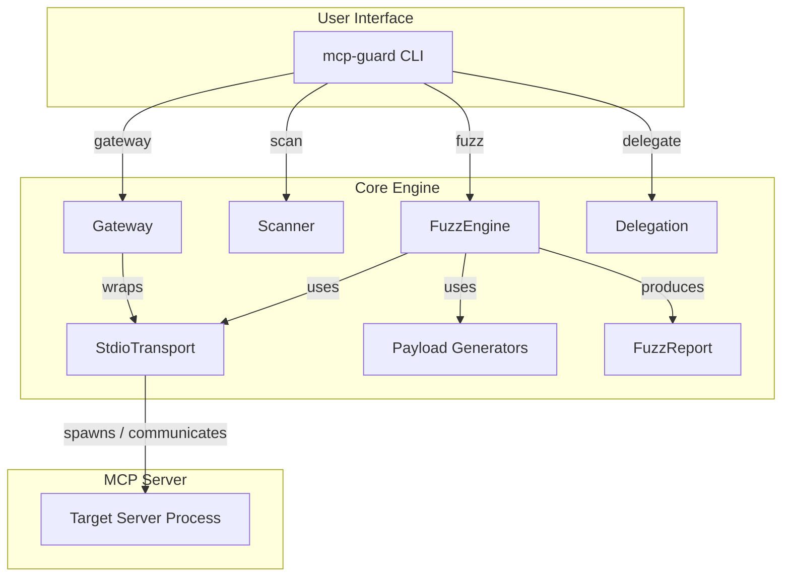
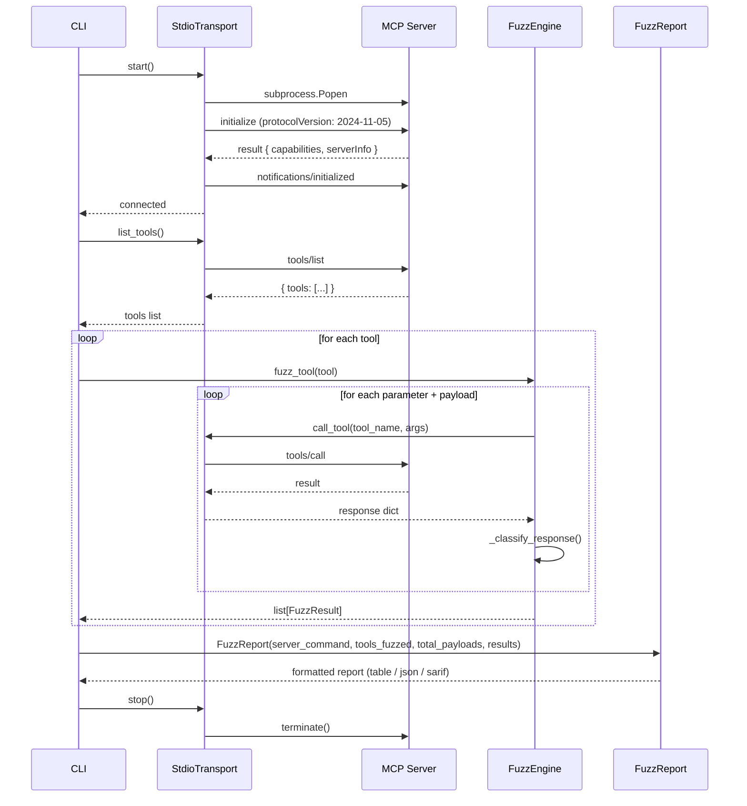
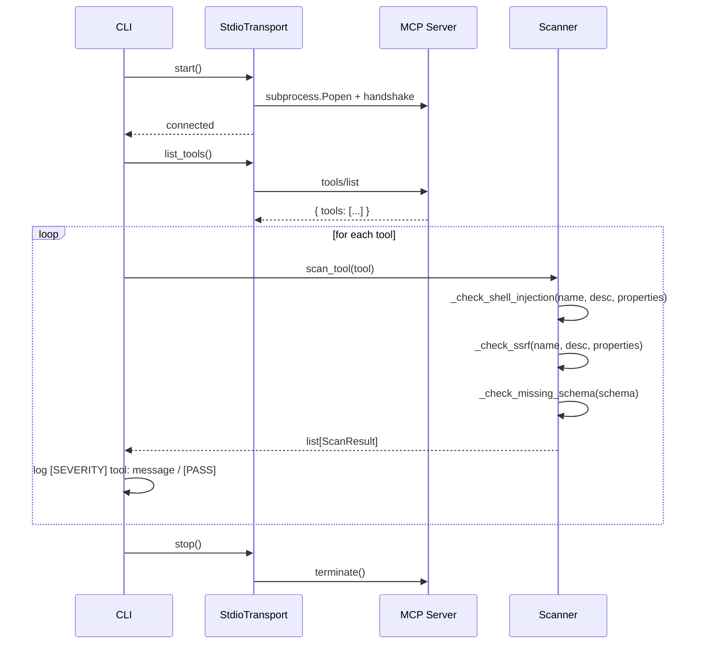
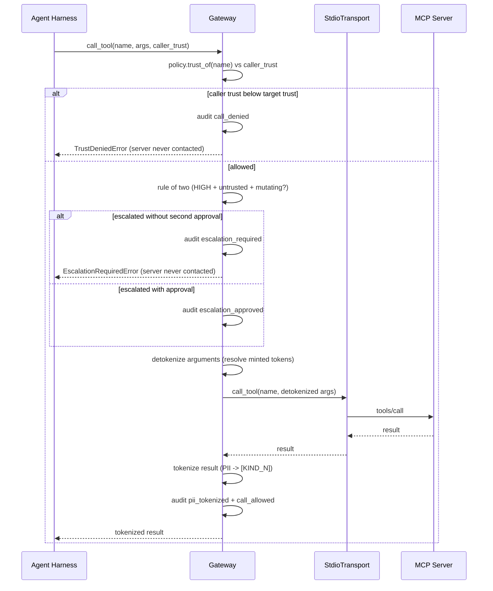

# Architecture

## Overview

mcp-guard is a zero-dependency Python library and CLI tool for adversarial fuzzing of MCP (Model Context Protocol) servers. It operates in two modes: **dynamic fuzzing** (spawning a server and sending real payloads) and **static scanning** (analyzing tool schemas — the server is spawned to enumerate itself, but no payloads are ever fired).



---

## Transport Layer

The transport layer handles all communication with the target MCP server. It is responsible for process lifecycle, JSON-RPC framing, and handshake negotiation.

### StdioTransport

`StdioTransport` spawns the target MCP server as a subprocess and communicates via stdin/stdout using newline-delimited JSON-RPC 2.0 messages.

**Key responsibilities:**

1. **Process Spawn**: Launches the server command with `subprocess.Popen`, piping stdin/stdout/stderr.
2. **Handshake**: Sends an `initialize` request with protocol version `2024-11-05` and client info (`mcp-guard`, `0.2.1`), then sends `notifications/initialized`.
3. **Request/Response**: Implements request-response correlation via incrementing `id` fields on JSON-RPC 2.0 request envelopes. Notification-shaped messages (`method` present, no `id`) are rejected as invalid responses.
4. **Error Handling**: Raises `ConnectionError` when the server process exits, closes its stdout, or returns a notification-shaped message. Raises `RuntimeError` on MCP-level errors. Raises `TimeoutError` when no response arrives within the configured timeout.
5. **Resource Management**: Supports context-manager protocol (`with` statement) for clean startup/shutdown. Terminates the process gracefully on exit, with a fallback to `kill()` if termination times out.
6. **Concurrency**: Strictly serial. `_read_response` spawns one reader thread per request (threading + queue) so a hung server cannot block the timeout; there is no request pipelining, and a timeout kills the server process outright.
7. **Flight Recorder**: `_send` records the exact JSON-RPC envelope of every request and `_read_response` records the response id, exposed via `last_exchange()`. This is the independent channel for fault-delivery verification (mcp-guard#65): the fuzzer checks the envelope against the intended call and the response id against the request id, instead of trusting the response content alone. Only the most recent exchange is kept; the fuzzer reads it immediately after each `call_tool`, and the engine is strictly serial, so one envelope is enough.

**Interface:**

```python
class StdioTransport:
    def __init__(self, command: list[str], timeout: float = 10.0) -> None: ...
    def start(self) -> None: ...
    def stop(self) -> None: ...
    def __enter__(self) -> StdioTransport: ...
    def __exit__(self, *args) -> None: ...
    @property
    def is_alive(self) -> bool: ...
    def list_tools(self) -> list[dict]: ...
    def list_resources(self) -> list[dict]: ...
    def list_prompts(self) -> list[dict]: ...
    def call_tool(self, tool_name: str, arguments: dict) -> dict: ...
    def last_exchange(self) -> tuple[JsonDict | None, Any]:
        """Flight recorder (mcp-guard#65): the exact envelope of the most
        recent tools/call send plus the id of its response."""
        ...
```

### Sequence Diagram: Dynamic Fuzzing Flow



---

## Fuzzing Engine

`FuzzEngine` is the core dynamic testing component. It receives a transport and a tool schema, generates targeted payloads, fires them, and classifies responses.

### Payload Generation

Payload generation is **schema-aware**. The engine inspects each parameter's `type` and `format` fields, plus parameter names, to select the appropriate payload suite.

```mermaid
flowchart TD
    A[fuzz_tool(tool)] --> B{has inputSchema?}
    B -->|No| C[_fuzz_no_schema]
    B -->|Yes| D{for each param}
    D --> E{is URI param?}
    E -->|Yes| F[generate_ssrf]
    D --> G{param type?}
    G -->|string| H[shell + prompt + indirect + overflow3 + type_confusion_string]
    G -->|integer/number| I[type_confusion_integer + overflow_maxint]
    H --> J[fire payload]
    I --> J
    F --> J
    C --> J
    J --> K[_classify_response]
    K --> L[SAFE / FINDING / CRASH / ERROR / INCONCLUSIVE]
```

**Payload counts per input type:**

| Input Type | Payloads |
|------------|----------|
| String parameter | 29 |
| URI-typed string parameter | 37 |
| Integer / number parameter | 9 |
| No input schema | 24 |

Tools with no input schema are fuzzed with the shell + SSRF + first-two-overflow + prompt-injection suites; each payload is fired with its `rule_id` (e.g. `"shell-injection"`) as the argument name, since there is no schema parameter to bind to.

**Post-crash behavior:** the engine does not stop when the server dies. Every remaining payload then raises `ConnectionError("Server not running")` in `_send` — but the fault-delivery check (below) now tells a genuine crash from a phantom one: a payload whose send was recorded before the death is a real CRASH, while a payload the dead server never received is INCONCLUSIVE, not a crash. One real crash therefore no longer manufactures phantom CRASH findings for all unfired payloads.

### Fault-Delivery Verification (Twyman's law, mcp-guard#65)

Source (established): Kohavi, Tang & Xu, *Trustworthy Online Controlled Experiments* (2020), ch. 18 (Twyman's law — any figure that looks interesting or different is usually wrong) and ch. 21 (telemetry fidelity as a trust-related guardrail metric). Adaptation: every fuzz probe is an experiment whose treatment is the injected payload, so fault-delivery evidence is mcp-guard's telemetry-fidelity guardrail. A SAFE verdict is meaningless if the payload never landed — the interesting-looking success that is really an instrumentation miss.

Mechanism (`src/mcp_guard/delivery.py`, stdlib only): before classification, `_fire_payload` verifies delivery on the transport's flight recorder, an independent channel from the response content. `verify_send` checks the recorded envelope is a JSON-RPC 2.0 `tools/call` for the intended tool with canonical-JSON-identical arguments; `verify_delivery` additionally requires the response id to match the request id (compared as strings, since JSON-RPC ids may be numbers or strings). A present-but-mismatched id is UNDELIVERED (stale or replayed response); a missing response id is UNKNOWN (correlation unverifiable, not proof). A probe whose delivery is not DELIVERED becomes `INCONCLUSIVE` — discarded as inconclusive, never counted as passed, and kept visible with its rule id and severity. A transport with no flight recorder cannot produce a SAFE verdict at all (fail-closed). On the crash path the send side alone decides: recorded send plus death is CRASH, no recorded send is INCONCLUSIVE.

What the recorder proves, and what it does not: the channel proves the exact envelope the transport wrote and that the server echoed its id — it catches stale/replayed responses, silent validators, dead-server phantom crashes, and JSON-RPC error servers. It cannot prove server-side dispatch: a middleware stub that answers `isError` with a matching id and varied text per payload, without ever reaching the tool, is indistinguishable from a strict validator by any black-box client-side check, including this one. That residual gap is closed only by the server-log step of the audit procedure, not by code. (A stub returning the same canned text for every payload IS caught: T3 withholds CLEAN on identical response text.) Likewise on the crash path, a write that lands in the OS pipe buffer moments before the server dies is recorded as a send; the race between "written" and "dispatched" cannot be resolved from the client side, so a crash verdict means "recorded send plus death", not "proved dispatch".

Run level (`src/mcp_guard/report.py`): `twyman_audit` withholds CLEAN when the pass rate looks surprising — T1, 100% SAFE with any delivery unconfirmed; T2, 100% SAFE with zero bytes of response text across the run; T3, 100% SAFE with the same non-empty response text on every probe (at least two probes). T1 is enforced live per-probe: the engine demotes any unconfirmed probe to INCONCLUSIVE before classification, so no SAFE result can ever carry unconfirmed delivery through the engine — the report-level T1 fires only on hand-built reports, and the outcome is the same either way. A 100% SAFE run with full delivery and varied error text does not trigger: that is a real validator, not a surprising result. A run that fired no probes is INCONCLUSIVE, never a vacuous CLEAN. Verdict precedence is crashes, then inconclusive probes, then errored probes, then findings, then the Twyman audit (which applies only to all-SAFE runs), then clean: an ERROR probe produced no verdict about its tool, so any error withholds CLEAN just as an inconclusive probe does — and it sits above findings, so one INFO finding cannot flip an error-dominated run back to a passing exit code. The CLI exits `1` on an inconclusive run so CI fails rather than passing a verdict the instrumentation cannot back.

Completing an audit: when the verdict is withheld, the audit procedure is (1) read the JSON report's summary `delivery` block and `twyman_audit` block: `delivered` vs total tells you whether the faults landed at all (per-probe `delivery_detail` plus `request_id`/`response_id` are in the JSON `results` array for every non-SAFE probe; the summary `request_ids` list carries the ordered request ids for the whole run, including SAFE probes, which are excluded from that array by design — so for an all-SAFE hold, match server-side dispatches against the summary `request_ids` and the aggregate counts); (2) check the server-side logs for a `tools/call` dispatch per probe — the run id and timestamp in `_provenance` identify the run, and each probe's `request_id` names its call (request ids run sequentially from the handshake); dispatch logged for every call means the server genuinely rejected them, no dispatch means a middleware stub rejected everything before tool dispatch and the run was never a test; (3) re-run after fixing the instrumentation or the server. For T2 specifically, a known terse validator whose error responses legitimately carry no text is the one legitimate override: `--allow-empty-error-responses` records the operator's assertion in the report (table note + JSON `twyman_audit.allow_empty_error_responses` + SARIF `mcp-guard.allow_empty_error_responses`) instead of silently passing. For T3, a known strict validator whose error responses legitimately repeat the same short text has the parallel override `--allow-identical-error-responses`, recorded the same way. There is no override for unconfirmed delivery — that can only be fixed, never asserted away. This file's FuzzResult listing names the `delivery`, `delivery_detail`, `request_id`, and `response_id` fields; `tests/test_twyman_delivery.py` is the enforcement row (this repo has no agentgate-style anatomy registry, so the executable tests plus `verify_counts` plus CI are the enforcement, not this prose).

### Response Classification

`_classify_response` maps a tool call's outcome to a category plus an evidence-graded severity. The deliberate default is **FINDING, never SAFE**: for a pre-deployment security fuzzer, a silently-executed payload is observationally identical to a neutralized one, and resolving that ambiguity as SAFE would let a CLEAN verdict assert safety it cannot verify. The operational cost is honest: a full fuzz run reports an info-level FINDING for every payload that produced no observable effect, so triage at scale means filtering by severity and rule id, not reading every row.

| Outcome | Category | Severity | Rule ID pattern |
|---------|----------|----------|-----------------|
| `isError: true` — server explicitly rejected the payload | SAFE | payload's severity | — |
| Payload was an `indirect-injection` probe and `INDIRECT_CANARY` appears in the tool **output** — attacker-controlled input was reflected onto the data channel a downstream agent reads (OWASP ASI01, EchoLeak/CurXecute pattern) | FINDING | high | `reflection-untrusted-echo` |
| Payload was an `indirect-injection` probe and the tool output contains a markdown image pointing at an external URL — an exfil channel | FINDING | critical | `indirect-injection-exfil-channel` |
| `isError: false` and the response text leaks internal information (keywords: `traceback`, `exception`, `stack trace`, `error:`, `internal`, `password`, `secret`, `token`) | FINDING | high | `{payload.rule_id}-info-leak` |
| Payload bytes (≥6 chars) were reflected in the tool output but nothing executed — reflection is not execution. Execution-class payloads (shell, SSRF, overflow) are capped at medium; only `prompt-injection`/`indirect-injection` keep the payload's severity, because there the reflection itself reaches a downstream agent | FINDING | medium (or payload severity for prompt-injection) | `{payload.rule_id}-unconfirmed-reflection` |
| Payload produced no observable effect — not reflected, no error, no leak. Silent execution cannot be ruled out by black-box probing alone | FINDING | info | `{payload.rule_id}-no-observable-effect` |
| `ConnectionError` raised during `call_tool` and the flight recorder shows the send was written before the death — the fault landed and the server died on it | CRASH | payload's severity | payload's `rule_id` |
| `ConnectionError` raised during `call_tool` and the flight recorder shows no send for this call — the server was already dead, the fault never went out | INCONCLUSIVE | payload's severity | payload's `rule_id` |
| Any other exception during delivery | ERROR (delivery confirmed) / INCONCLUSIVE (delivery unconfirmed) | payload's severity | payload's `rule_id` |
| Delivery check fails (envelope mismatch, response-id mismatch, or no flight recorder) — regardless of what the response content says | INCONCLUSIVE | payload's severity | payload's `rule_id` |

**Check order matters:** the canary check runs before the exfil-channel check. Because the exfil payload itself embeds `INDIRECT_CANARY`, a server that echoes the payload verbatim produces `reflection-untrusted-echo`, not `indirect-injection-exfil-channel` — the latter fires only when the server strips the canary but keeps the markdown-image exfil channel.

---

## Scanner Pipeline

`Scanner` performs static analysis of MCP tool schemas without spawning a server. It uses keyword matching and schema inspection to flag high-risk patterns.

### Rules

| Rule ID | Severity | Condition |
|---------|----------|-----------|
| `shell-injection` | CRITICAL | Tool name or description contains shell-related keywords (`bash`, `shell`, `command`, `exec`, `powershell`, etc.) OR a parameter name or description matches those keywords |
| `ssrf-risk` | CRITICAL / WARNING | Parameter has `format: uri` or name/description matches URL keywords. Downgraded to WARNING if the parameter has an `enum` constraint |
| `missing-schema` | WARNING | Tool has no `inputSchema` or no `properties` defined |

### Flow

```mermaid
flowchart LR
    A[scan_tool(tool)] --> B[_check_shell_injection]
    A --> C[_check_ssrf]
    A --> D[_check_missing_schema]
    B --> E[ScanResult?]
    C --> E
    D --> E
    E -->|yes| F[return findings]
    E -->|no| G[PASS]
```

### Sequence Diagram: Static Scan Flow



Note the scan path reports through the logging channel (one `[SEVERITY]`/`[PASS]` line per tool); it does not build a `FuzzReport`. No payloads are ever fired — the server is only asked to describe itself.

---

## Gateway

`Gateway` (`src/mcp_guard/gateway.py`, rat #66) is the central choke point
between an agent and MCP servers: every agent tool call passes through it, and no
agent tool call reaches a server except through it. (The fuzzer's own probes do
not run through the gateway.) It implements the same
`Transport` protocol the `FuzzEngine` uses (`call_tool` + `last_exchange`),
so it drops into any transport consumer unchanged — with one deliberate
deviation: `last_exchange` withholds the request envelope (it would carry
the detokenized arguments) and returns only the response id, so the
fuzzer's delivery check through a gateway degrades to UNKNOWN, visibly,
never DELIVERED. The fuzzer does NOT run through it (tokenized responses
would break reflection classification).
The gateway is the agent path; the fuzzer is the audit path.

### Trust-Level Enforcement

`GatewayPolicy` maps tool names to `TrustLevel` (`high` / `medium` / `low`)
plus a declared default for unlisted tools. The default is LOW: an unlisted
tool can never trigger a higher-trust read, and trust is never guessed
upward. `Gateway.call_tool(tool_name, arguments, caller_trust)` denies the
call before any send when the caller's declared trust is below the target
tool's trust — typed `TrustDeniedError`, audit event `call_denied`, and the
inner transport is never called (pinned by a fake transport recording
sends). An undeclared caller is LOW (least privilege, never root).

### Rule of Two (rat #69)

`src/mcp_guard/escalation.py` evaluates the rule of two on every gateway
call — gateway calls only, not every tool call system-wide: the fuzzer
is exempt (it does not run through the gateway, and fuzz probes can
mutate server state without any approval; see the gateway section
above). A HIGH-trust tool that mutates state
(`GatewayPolicy.mutating_tools`) on untrusted input (`input_trust`,
default UNTRUSTED) escalates. Without a second approval (`SecondApproval`,
non-empty approver + reason) the call is denied before any send (typed
`EscalationRequiredError`, audit event `escalation_required`); with one it
proceeds and the approval is audited (`escalation_approved`, approver name
recorded as a per-session `[APPROVER_n]` token — the whole field is
pseudonymized, never verbatim, and the token can never be resolved back
to the value; reason text never recorded). Trust denial precedes escalation.
`Lifecycle.call_tool` and the gateway CLI (`input_trust` / `approval` keys)
thread the same parameters through. Only HIGH is sensitive; input trust is
caller-declared and the approver cannot be authenticated (same
declared-identity boundary as caller trust); a tool the policy omits is not
known-mutating. Policy load is fail-closed on malformed shapes, and a
`mutating_tools` entry whose effective trust is not HIGH is rejected at
load — it could never escalate, so accepting it would fake two-person
control. Omission of a HIGH tool from `mutating_tools` cannot be
detected (a HIGH read-only tool legitimately omits it) and silently
disables escalation for it. Residual risk: the same caller can attach
its own approval to the same request line, or declare its input
trusted, and bypass escalation — the control stops accidental or
omitted second sign-off and creates an audit trail, it does not enforce
two distinct humans; the harness must obtain approval from a distinct
principal out of band.

The gateway enforces policy over the caller's DECLARED trust level: MCP
tools/call carries no caller identity, so the gateway cannot authenticate
who is calling — the agent harness declares it, and every audit event
records the declared caller so a lying caller is visible. Identity
authentication (OAuth / JWT / mTLS) is a deployment concern outside this
stdlib library.

### Pre-Model Tokenization

Tool results are tokenized before they are returned to the model.
`PiiTokenizer` replaces structured PII with deterministic per-session
tokens (`[EMAIL_1]`, `[PHONE_1]`, `[SSN_1]`, `[CREDIT_CARD_1]`,
`[API_KEY_1]`): the same value maps to the same token within a session, so
the agent can correlate across records without seeing the value. Tokenization
covers dict keys as well as values, and tuples as well as lists. When the
agent passes a token into a later tool call, the gateway resolves it back
before sending. Only tokens the gateway itself minted are resolved:
token-shaped text it never minted passes through untouched, and
`[EMAIL_1]` never corrupts `[EMAIL_10]` during resolution. Resolution is a
single pass, so a substituted value is never re-scanned.

Detection is two-layer by design. Layer 1 is `RegexDetector` over structured
formats (email, phone, SSN, card numbers with a Luhn check so a 16-digit
order number does not tokenize as a card, API-key shapes). Layer 2 is the
pluggable `Detector` protocol (e.g. NLP): the gateway ships regex-only and
documents the gap — names and addresses need layer 2. The token-to-value
mapping lives in memory only, is never serialized, and is wiped between
sessions (`PiiTokenizer.clear`).

### Audit Log: Events, Never Content

`GatewayAuditLog` records the fact of access, never the data. Event kinds
are `call_allowed`, `call_denied`, `escalation_required`,
`escalation_approved`, `pii_tokenized`, `token_resolved`; each
event carries the tool name, caller and target trust levels, token kinds and
counts, and the JSON-RPC request id. Values never appear in any event,
with one deliberate exception: the approver's name on
`escalation_approved`, recorded for accountability as a per-session
`[APPROVER_n]` token (the whole field is pseudonymized, never verbatim,
and the token can never be resolved back to the value). The
approval reason text is never recorded. The
log serializes to JSON for SIEM ingestion.

### Report Scrubbing (rat #69)

Fuzz reports are the other external surface: `FuzzReport` formatters
(table/JSON/SARIF) scrub every content string through the `PiiTokenizer`
at the emit boundary (`_scrubbed`), before any preview truncation
and with no opt-out, so no raw structured PII of the detected classes
(email, phone, SSN, Luhn cards, API-key shapes) from a server response,
finding detail, payload, tool/probe name, request/response id, server
command, or verdict reason reaches a report. Names and bare 9-digit
national IDs are outside the detected classes and are excepted. In-memory
results stay raw (`verify_counts` recomputes from unmodified data); one
fresh tokenizer per emit keeps tokens consistent within a report and
discarded with it. Tokens cannot be resolved back from a report — to
investigate a scrubbed finding, re-run the probe against a fixture and
inspect the live server response out of band.

### Sequence Diagram: Gateway Call Flow



---

## Delegation

`DelegationRunner` (`src/mcp_guard/delegation.py`, rat #67) runs one delegation
under a contract declared in agent frontmatter. An agent file is a Markdown
file whose head is a YAML `---` block declaring: `name` (required,
lowercase-hyphen), `description` (required), `tools` allowlist,
`denied_tools` denylist (applied first), `permission_mode`
(`default` / `acceptEdits` / `auto` / `dontAsk` / `bypassPermissions` /
`plan` / `manual`), `isolation` (`none` / `worktree`, default `worktree`),
`effort` (`low` / `medium` / `high` / `xhigh` / `max`, unset means inherit
the routed task kind's effort), `max_turns` (default 25), `memory`
(`user` / `project` / `local` / `none`), `model` (default `inherit`),
`background` (default `false`; `true` is rejected: this runner is
synchronous). `isolation: none` is an explicit opt-in, and `delegate()`
logs a warning for it: in that mode the junior edits the operator's
working tree directly and verification gates acting on the changes, not
their presence. A file
with no frontmatter, an unclosed block, or an unknown field is rejected
(`FrontmatterParseError`); a missing required field is rejected
(`ContractRejectedError`): a delegation without
a declared contract cannot proceed, and a verbal "be careful" in the prompt
is never a contract. The parser covers the flat subset only (`key: scalar`
and `- item` lists, indented up to 4 spaces); nested maps, anchors,
multi-line values, flow lists (`[a, b]`), and bare-scalar lists
(`tools: Bash`) are parse errors, and an empty list item is a parse error
too, because PyYAML is a dev-only dependency and the runtime is stdlib
only. Tool names normalize (strip + lowercase) before the check, and
`is_tool_allowed` denies every tool for an empty allowlist (fail-closed):
a contract that declares no tools delegates no tool use through a
mediating harness.

The contract fields only a junior runtime can act on (`tools`,
`permission_mode`, `max_turns`, `effort`, `memory`, `model`) are forwarded
to the junior as `MCP_GUARD_CONTRACT_*` environment variables and as a JSON
contract file (`MCP_GUARD_CONTRACT_FILE`) as requests: nothing in this
library enforces them on an arbitrary subprocess, and a junior that
ignores them is not stopped by this library. This library enforces
directly: contract parsing and validation, worktree isolation, the three
loop-prevention layers, prompt scrubbing and the minimal child environment,
and the pending-to-approved gate. `is_tool_allowed` is the check a harness
applies when it mediates a tool call on the junior's behalf; it is a
helper for that harness, not an enforcement point in this runner.

### Three-Layer Loop Prevention

All three layers must pass before any delegation proceeds (`LoopGuard`):

1. **Environment preservation**: the `MCP_GUARD_DELEGATION_DEPTH` marker is
   inherited by the child process; a delegation running inside a delegation
   is refused (nesting depth max 1). An unparsable marker is refused too,
   and so is a negative depth (a negative marker is not a deeper budget).
2. **Lock file**: one live delegation per delegation id, via a kernel
   arbiter held for the whole delegation (`flock` on POSIX, a named
   mutex on Windows); the pid file (mode `0600`) records which pid
   holds the id, and a stale file is never unlinked by an acquirer —
   only by the holder on release, while it still holds the arbiter —
   so two concurrent reclaimers cannot strand two holders on one id.
   A stale lock is reclaimed only when the recorded pid is dead
   (liveness check); a corrupt lock file is fail-closed and stays
   locked until an operator removes it. The lock spans the junior
   run AND the verification step while `delegate()` holds it: a second
   delegation with the same id cannot start while the first is still running.
   Once `delegate()` returns a result that is still `pending_verification`,
   the lock is released — but the pending obligation is durable: a pending
   record (`<lock-dir>/<id>.pending.json`, with the staged worktree path
   when there is one) plus a `delegation_pending` audit event record that
   verification is still owed, so the fact survives the process exit. A
   fresh delegation with the same id is refused while staged work exists
   for it; discharge it with `delegate --resolve-pending <id>` and a
   senior verifier. Guard state lives outside the repo by default
   (`~/.mcp-guard/<repo-hash>`); `--lock-dir` overrides it. The lock
   dir exists so guard state never lands in the repo tree and is never
   committed or collected as a change; it may point at the repo root, in
   which case guard files are excluded from change collection exactly.
3. **Audit rate-limit**: the append-only JSONL audit log counts delegation
   attempts in a sliding window across processes (default max 5 in 60 s);
   over the cap the delegation is refused. The check and the `STARTED`
   record are serialized under a global audit lock, so the cap is a real
   bound even under concurrency. Every refusal is recorded as a
   `loop_refused` event naming the layer, including lock refusals. Audit
   reads are bounded to the last 1 MB; corrupt lines are skipped, naive
   timestamps are coerced to UTC, and future-dated events are not counted.

The three layers are guardrails against accidental re-delegation, not a
security boundary: a fresh delegation id gets a fresh lock, deleting the
audit file resets the rate count, and a junior that unsets the depth
marker can re-delegate (the lock and the rate limit still bound that
case).

### Secret Scrubbing and Senior Verification

The task prompt is tokenized with the rat #66 `PiiTokenizer` before it
reaches the junior command, and the junior's environment is built from a
small allowlist (`PATH`, `HOME`, and locale/temp vars, plus `--allow-env`
extensions): the scrubber replaces recognised PII patterns (email, phone,
SSN, card numbers) in the prompt, and the allowlist drops every other
exported variable. It does not redact arbitrary secrets: an API key, token,
or password in the prompt reaches the junior verbatim, and any variable named
in `--allow-env` passes through unscrubbed by operator choice. A prompt,
contract description, or model string that looks secret-bearing warns on
stderr and leaves a `secret_shape_warned`
audit event naming only the shape kinds, never values, so the crossing is
not silent. Keep secrets
out of the prompt and out of the allowed environment; the junior runtime is
untrusted by design. The audit
log records kinds and counts plus the scrubbed prompt's hash, never values,
and the printed delegation summary carries the shape kinds found.
A `DelegationResult` starts `pending_verification` and only a
`SeniorVerifier` verdict of `approved` transitions it to `complete`;
`complete()` raises unless the result is approved, a second verdict raises
instead of overwriting the first, and direct assignment to `state`,
`verification`, or `rejection_reason` raises. Without a verifier the
result stays pending and the `delegate` CLI exits 2. The routing matrix
(`ROUTING_MATRIX`) maps each of the ten task kinds to its trigger surface,
effort, and senior verification step — typed enums, no stringly-typed
state. The runner checks the routed step's mechanical preconditions
before consulting the verifier (a `run_tests_red` step needs a changed
test file, a `read_only_report` or `read_results_escalate` step needs junior
output, a `check_exit_and_diff` or `semantic_diff_check` step needs a changed
file when the delegation runs against a repo directory); a failed precondition
rejects without a verdict. `worktree` isolation runs the junior in a
fresh `git worktree add` temp dir; the junior's changes stay staged in
the worktree until the senior verifier approves them: only an APPROVED
verdict copies them back to the main tree (deletions and renames
mirrored) and removes the worktree. A rejection discards the staging;
without a verifier the result stays pending, the worktree is kept, and
a pending record (`<lock-dir>/<id>.pending.json`) plus a
`delegation_pending` audit event record where the staged work lives;
`delegate --resolve-pending <id>` discharges it later with a senior
verifier, which always re-runs: a stored APPROVED verdict in the record
is audit history only and is never trusted. Resolve never trusts the
record's stored change list or HEAD snapshot either: it re-derives the
change list from live state (the worktree, or live git status
against HEAD for isolation none — the record carries no baseline,
so operator dirt present before the run is shown to the verifier
rather than hidden), recomputes the HEAD baseline from live git
and refuses to land when it is unavailable, refuses a worktree
that is not exactly this delegation's
(``<lock-dir>/<id>.worktree``), is not registered in the
operator-supplied repo, or whose isolation disagrees with the
stored contract, refuses an isolation-none record while staging
for its id exists on disk or is registered in the operator repo
(the contract and the worktree field live in the same unsigned
record, so a coherent flip of both cannot be the anchor — live
git is), or a change path that escapes the tree, and runs
the routed step's mechanical precondition before the verifier. What the record still supplies, because it cannot
be re-derived, is the task, the junior exit code, and the junior
output — bounded by shape invariants (a worktree record cannot
be timed out, a non-timeout record must carry an exit code, a
timeout record must carry none). Report-kind steps cannot be
resolved from a pending record at all: their deliverable is the
recorded junior output, so re-run the delegation with a verifier,
or discard the pending record with ``delegate --discard-pending <id>``
(the staged worktree is removed — decided by live git, never by
the record's worktree field, and verified after removal; in
isolation-none mode the junior's edits stay in the tree, unapproved).
The repo is supplied by the operator at resolve time
(``--repo-dir``); the stored repo is never used on its own, and
``--no-repo-dir`` refuses a record that names one. Resolve is
operator-driven and is not rate-limited. The verifier runs where the
deliverable lives — the worktree in worktree mode, `repo_dir` otherwise
— so a `--verify-command` sees the bytes it judges. The verifier runs
with a 60 s timeout; a verifier that times out rejects. A
copy-back failure raises (the worktree is kept for recovery) with a
`copyback_failed` audit event, and the result stays pending rather than
complete with unlanded files. Copy-back refuses, audited the same way,
when the target's current bytes differ from its HEAD blob — uncommitted
operator work, dirty before setup or edited while the delegation ran —
(conflict) or a worktree file changed after verification (drift) — a raw byte difference git reads as clean (line-ending conversion under core.autocrlf) is not operator work and does not refuse: landing bytes the
senior never saw, or overwriting the operator's concurrent edits, is
never done silently. Copy-back is not atomic across files: if a later
file conflicts, earlier files have already landed while the result
stays pending (the landed bytes were senior-approved, and a retry
passes them as byte-identical no-ops). A timed-out junior's staged worktree work is
discarded (TIMEOUT is terminal). Worktree isolation is filesystem-level,
not a sandbox, and a failed setup refuses the delegation rather than
silently degrading to unisolated execution. A git failure while
collecting changes raises loudly when a repo is present instead of
reporting a clean tree.

### Sequence Diagram: Delegation Flow

```mermaid
sequenceDiagram
    participant H as Operator
    participant R as DelegationRunner
    participant L as LoopGuard
    participant J as Junior Command
    participant V as SeniorVerifier

    H->>R: delegate(contract, task, prompt)
    R->>R: parse_frontmatter (reject if no contract)
    R->>L: guard: env depth, rate limit, lock
    alt any layer refuses
        L->>L: audit loop_refused
        L-->>H: LoopRefusedError
    else guarded
        R->>R: tokenize prompt (PII -> [KIND_N])
        R->>R: audit delegation_started (kinds, counts, hash)
        R->>J: run junior (scrubbed prompt on stdin, minimal env, contract file)
        J-->>R: stdout, stderr, return code
        R->>R: check routed step preconditions
        alt precondition fails
            R->>R: state REJECTED (verifier not consulted); discard worktree
        else preconditions pass
            R->>V: verify(result)
            alt approved
                V-->>R: APPROVED
                R->>R: copy worktree changes back to the main tree
                R->>R: state COMPLETE
            else rejected
                V-->>R: REJECTED
                R->>R: state REJECTED; discard worktree
            end
        end
        R-->>H: DelegationResult
    end
```

---

## Lifecycle

`Lifecycle` (`src/mcp_guard/lifecycle.py`, rat #68) is the ownership layer
over the gateway: a task enables exactly the servers it names, calls route
only through those servers, and ending the task stops every server and
VERIFIES each one is actually dead before the task record is dropped.
Default-deny is structural: no server runs until a task enables it by name,
and a call naming a server the task did not enable is refused before any
send (`ServerNotEnabledError`, audit event `server_denied`).

`ServerRegistry` maps names to spawn commands, parsed fail-closed from a
JSON file (`{"servers": {name: [command...]}}`). `Lifecycle.begin_task`
validates everything before starting anything (non-empty id, no live
duplicate, all names known, none owned by another live task, non-empty
enable list); a start failure part-way through rolls back the
already-started servers and re-raises, so a failed begin never leaves a
half-enabled task behind. One server belongs to at most one live task at a
time. All of a task's servers share the lifecycle's one `PiiTokenizer`,
so a token minted on one server resolves on another server of the same
task; `end_task` clears it while its counters stay monotonic across
tasks, so a stale token from a finished task passes through as literal
text and can never silently rebind to a different value in a later task.

`Lifecycle.end_task` stops every bound transport and then independently
probes `is_alive` until the process is gone (bounded poll loop: the probe
reads the OS process table, never a flag the transport sets). The result
is a frozen `TeardownReport` (task, servers, verified, failed, `ok`,
plus `pids` — each server's OS process id, so a survivor can be killed
out of band). Any survivor raises `TeardownFailedError` carrying the
report instead of returning clean, and the task stays live so the caller
can retry the teardown. The lifecycle audit log (`LifecycleAuditLog`)
records `task_begun` / `server_enabled` / `server_denied` / `task_ended` /
`teardown_verified` / `teardown_failed` with task/server names and
outcomes only, never arguments or content.

The gateway CLI is the lifecycle's production consumer: the session is one
task. Without `--servers`, the single server after `--` is the session's
task (auto-begin, auto-end on EOF with verified teardown reported in the
`gateway_closed` line). With `--servers`, the session starts with NOTHING
enabled; stdin control lines `{"task": "begin", "servers": [...]}` /
`{"task": "end"}` narrowly enable servers per task, and call lines carry
an optional `"server"`. A transport-level call failure is an error line
for that request, never a dead session; a begin whose tools/list fails
rolls the task back. A single-server session that fails before its first
line (begin or tools/list) still prints the `gateway_closed` line,
carrying the error, and exits 1. A tools/list failure also carries the
rolled-back teardown report; a begin failure carries `"teardown": null`
(no task ever existed to tear down), and a begin whose rollback leaves a
server alive records a `teardown_failed` event in the lifecycle audit
log instead of reporting clean.
In multi-server mode the `gateway_closed` line
carries per-server gateway audits (`"server_audits"`). `fuzz` / `scan`
are single-run tools that exit when done, so they keep their existing
context-manager teardown, unchanged — their teardown is unverified by
the lifecycle.

### Sequence Diagram: Task Lifecycle

```mermaid
sequenceDiagram
    participant H as Agent Harness
    participant L as Lifecycle
    participant T as StdioTransport
    participant S as MCP Server

    H->>L: begin_task(id, [a])
    L->>T: start() (server a only; b stays down)
    T->>S: initialize
    L-->>H: TaskHandle(id, [a])
    H->>L: call_tool(id, b, ...)
    L->>L: audit server_denied
    L-->>H: ServerNotEnabledError (b never started)
    H->>L: call_tool(id, a, ...)
    L->>T: call_tool (via bound Gateway)
    H->>L: end_task(id)
    L->>T: stop()
    L->>T: is_alive? (poll until dead)
    alt all dead
        L->>L: audit teardown_verified + task_ended
        L-->>H: TeardownReport(ok)
    else survivor
        L->>L: audit teardown_failed
        L-->>H: TeardownFailedError (task stays live)
    end
```

---

## Report Generation

`FuzzReport` aggregates all `FuzzResult` objects and formats them into three output formats.

### Output Formats

| Format | Use Case | Consumer |
|--------|----------|----------|
| **Table** | Human-readable CLI output | Security engineers running locally |
| **JSON** | Structured data for pipelines | CI/CD systems, custom tooling |
| **SARIF** | Static Analysis Results Interchange Format | GitHub Security tab, CodeQL, other SARIF consumers |

### Table Output

Displays a summary header (tools fuzzed, payloads sent, crashes, findings, safe, errors, inconclusive, delivery counts) followed by detailed CRASHES, FINDINGS, and INCONCLUSIVE sections. Findings are truncated to the first 20 entries with a "… and N more" message. When the Twyman audit triggers, a TWYMAN AUDIT block lists the reasons the verdict is withheld.

### JSON Output

Includes a `summary` block and a `results` array. SAFE results are excluded from the JSON output to reduce noise. The summary carries `inconclusive`, a `delivery` count block (`delivered` / `undelivered` / `unknown`), a `twyman_audit` block (`triggered`, `reasons`, `safe_rate`), the ordered `request_ids` list for the whole run (so an all-SAFE hold can be audited per probe), and the run `verdict`. Each non-SAFE result carries its `delivery` status, `delivery_detail`, and `request_id` / `response_id`.

### SARIF Output

Maps each non-SAFE result to a SARIF `result` object with `ruleId`, `level` (`error` for crashes, `warning` for findings and for errored probes under the dedicated `probe-error` rule — an errored probe is not a finding, so it never shares a finding's rule id — `note` for inconclusive probes under the dedicated `fault-delivery-unconfirmed` rule), `message`, and a location of `physicalLocation.artifactLocation.uri = mcp://{tool_name}`. INCONCLUSIVE results are not findings, so they are `note`-level, never `warning` — but a SARIF-only consumer still sees which probe has no verdict and why: the message carries the probe's rule id and request id. The run properties record `mcp-guard.verdict`, `mcp-guard.inconclusive`, `mcp-guard.errors`, `mcp-guard.twyman_audit_triggered`, `mcp-guard.allow_empty_error_responses`, `mcp-guard.twyman_audit_t2_suppressed`, `mcp-guard.allow_identical_error_responses`, and `mcp-guard.twyman_audit_t3_suppressed`, plus the delivery counts (`mcp-guard.delivery_delivered` / `delivery_undelivered` / `delivery_unknown`), `mcp-guard.twyman_audit_reasons`, `mcp-guard.safe_rate`, and `mcp-guard.total_probes`, so a CLEAN verdict can be checked from the SARIF file alone.

### Provenance and count verification

Every emitted report carries a `_provenance` block (scanner identity, scanner version, run id, UTC timestamp, data source, payload-ruleset version), so a downstream consumer can answer "where did this number come from?" without trusting the channel the report arrived on. Category counts, `total_payloads`, and `tools_fuzzed` are recomputed from the raw results list by `verify_counts()`; the formatters refuse to emit a report whose summary disagrees with its results — they raise an exception (surfacing as exit code 1) instead of printing numbers that cannot be re-derived in code.

---

## CLI Interface

The CLI is built on `argparse` with four subcommands: `fuzz`, `scan`, `gateway`, and `delegate`.

### Subcommands

| Subcommand | Description | Options |
|------------|-------------|---------|
| `fuzz` | Dynamic fuzzing of a running MCP server | `--format` (table/json/sarif), `--delay-ms`, `--timeout`, `--allow-empty-error-responses`, `--allow-identical-error-responses` |
| `scan` | Static schema scan (no payloads fired) | `--format` (table/json) |
| `gateway` | Proxy MCP calls through the trust/tokenization gateway (rat #66) | `--policy` (required JSON policy file), `--servers` (optional JSON server registry) |
| `delegate` | Run one delegation under a frontmatter contract (rat #67) | `--contract` (agent file), `--task` (task kind), `--prompt-file` (prompt file), `--verify-command`, `--lock-dir`, `--repo-dir`, `--no-repo-dir`, `--max-delegations`, `--window-seconds`, `--timeout`, `--delegation-id`, `--allow-env`, `--resolve-pending` |

The `scan` subcommand accepts `--format` but currently reports through the logging channel (one `[SEVERITY] tool: message` / `[PASS]` line per tool) rather than formatted output. The `gateway` subcommand speaks JSON lines on stdout: first the annotated tool list (each tool with its `mcp_guard_trust_level`), then one line per request read from stdin (`{"tool": ..., "arguments": {...}, "caller_trust": "low"}`), then a `gateway_closed` line carrying the full audit log plus the verified teardown report (`"teardown"`) and the lifecycle audit log. A denied call prints `{"denied": true, ...}`; a malformed line or a failed call (server error envelope, dead server, hung call) prints `{"error": ...}` and never kills the session. With `--servers`, the session starts with nothing enabled and stdin control lines `{"task": "begin", "servers": [...]}` / `{"task": "end"}` manage tasks (rat #68 lifecycle); the first line is then `{"servers": [...]}` and call lines carry an optional `"server"`, and the `gateway_closed` line carries per-server gateway audits (`"server_audits"`) when a task is live at EOF. The `delegate` subcommand takes the junior command after `--`, prints one JSON line with the delegation summary, and exits 2 when the result is `pending_verification` (no senior verifier approved it). `delegate --resolve-pending <id> --verify-command <cmd>` discharges a pending delegation instead of starting a new one (`--contract`, `--task`, and `--prompt-file` are not needed then); the printed pending message names that command. The summary echoes bounded junior output (first lines only, never the whole stream). All four subcommands accept the server or junior command after `--`. Global flags: `--verbose`, `--quiet` (logging verbosity).

### Exit Codes

| Code | Meaning |
|------|---------|
| `0` | Clean or findings — no crashes, no inconclusive probes, no errors; informational findings are still reported and exit 0 by design |
| `1` | Error (connection failure, bad arguments) or inconclusive run (fault delivery unconfirmed, any probe errored, or Twyman audit triggered) |
| `2` | Crashes detected; `delegate` also exits `2` when the delegation result is `pending_verification` (no senior verifier approved it) |

### Argument Parsing

All four subcommands accept the server or junior command after `--`. The `fuzz` subcommand strips `--` tokens from the command list before passing to `StdioTransport` (the `scan`, `gateway`, and `delegate` subcommands do the same). Only the first `--` separator is stripped: a later `--` is part of the junior command, not a separator.

---

## Data Model

### FuzzResult

```python
@dataclass
class FuzzResult:
    tool_name: str
    probe_name: str
    payload_value: object
    category: ResultCategory  # SAFE | FINDING | CRASH | ERROR | INCONCLUSIVE
    rule_id: str
    severity: str  # critical | high | medium | low | info
    detail: str
    response_preview: str
    delivery: DeliveryStatus  # delivered | undelivered | unknown
    delivery_detail: str
    request_id: Any  # JSON-RPC request id, None when uncorrelatable
    response_id: Any  # JSON-RPC response id, None when none arrived
```

### ScanResult

```python
@dataclass
class ScanResult:
    rule_id: str
    severity: Severity  # CRITICAL | WARNING
    message: str
    tool_name: str
    remediation: str
```

### AuditEvent

```python
@dataclass(frozen=True)
class AuditEvent:
    seq: int
    timestamp: str
    kind: AuditKind  # CALL_ALLOWED | CALL_DENIED | PII_TOKENIZED | TOKEN_RESOLVED
    tool_name: str
    caller_trust: TrustLevel
    target_trust: TrustLevel
    token_kinds: tuple[str, ...]
    token_count: int
    request_id: int | str | None
```

### Payload

```python
@dataclass(frozen=True)
class Payload:
    value: object
    rule_id: str
    severity: Severity  # CRITICAL | HIGH | MEDIUM | LOW | INFO
    description: str
```

### DelegationContract

```python
@dataclass(frozen=True)
class DelegationContract:
    name: str
    description: str
    tools: tuple[str, ...]
    denied_tools: tuple[str, ...]
    permission_mode: PermissionMode
    isolation: Isolation
    effort: Effort | None
    max_turns: int
    memory: MemoryScope
    model: str
    background: bool  # always False: background: true is rejected
```

---

## Dependencies

mcp-guard has **zero runtime dependencies**. It uses only Python 3.11+ stdlib modules:

- `json` — JSON-RPC message encoding/decoding
- `subprocess` — server process spawn and lifecycle
- `threading`, `queue` — per-request reader threads with timeout in the transport
- `re` — exfil-channel pattern matching in the response classifier
- `dataclasses` — result and payload data structures
- `enum` — severity and category enums
- `argparse` — CLI argument parsing
- `sys` — exit codes
- `uuid`, `datetime` — report run ids and timestamps
- `typing` — type hints and Protocol definitions

Dev dependencies (`pytest`, `pytest-cov`, `ruff`, `mypy`, `pyyaml`) are optional and only needed for development.
